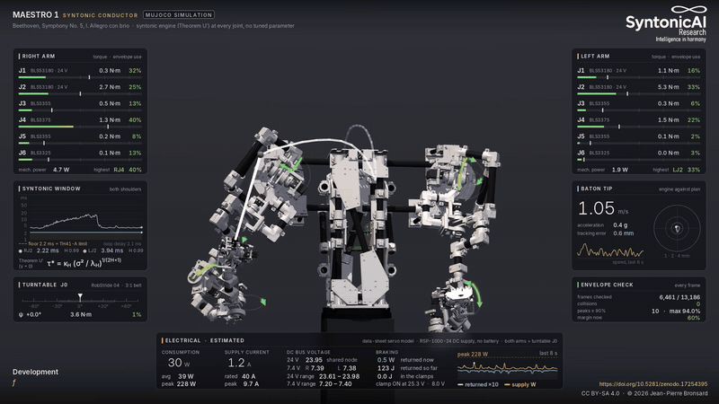

# Syntonic Engine: gains from measured facts, no tuning

**Gains from measured facts, no tuning.** Every law in this package computes its gains from statistics measured in the signal and a few facts about the machine measured once, never from tuning. The syntonic engine sets the time window of a correction or an estimate, by a law derived from first principles (Theorem U' of the Syntony Principle). Its only machine-specific inputs are three facts: the loop timing and delay; the actuator's authority in a correction loop, or, in an estimator that fuses a fast drifting sensor with a noisy absolute one, the fast sensor's drift; and access to the read noise. The engine decides when to correct, not how much. Since 0.3.0 two laws also set how much: the syntonic loop law computes a servo joint's PI gains from the disturbance spectrum it measures, within robustness margins, and the Riccati attitude law computes an estimator's gains from the noise and drift measured at each throttle level. Both are tested in simulation only (see 0.3.0 below).

Jean-Pierre Bronsard · SyntonicAI Recherche · Montréal QC Canada  
ORCID: [0009-0008-6639-7553](https://orcid.org/0009-0008-6639-7553)

[](https://doi.org/10.5281/zenodo.23549689)

[](https://github.com/jpbronsard/syntonic-engine/releases/download/v0.1.0/MAESTRO1_Syntonic_Conductor_v4_web.mp4)

*MAESTRO 1 conducting Beethoven's Fifth in a MuJoCo simulation, every arm joint driven by this engine. Seven seconds from the full video: [download the full video](https://github.com/jpbronsard/syntonic-engine/releases/download/v0.1.0/MAESTRO1_Syntonic_Conductor_v4_web.mp4) (7:28, 1080p, 324 MB, CC BY-SA 4.0).*

> **2 November 2026 (0.3.2): the loop law's gain recomputation, about three times cheaper on average in C++ and Rust, with the same gains.**
>
> - **What is new.** Two speed-ups of the loop law's gain recomputation, on by default in C++ and Rust. A candidate's sum stops as soon as it can no longer be chosen. And |1 + L|^2 is computed as a quadratic in Ki, which takes fewer operations. `ScanLoopLaw` is their Python reference. The frozen Python law is unchanged.
> - **The same gains.** Stopping a sum drops only candidates that cannot win. The quadratic form changes the predicted error by rounding only (at most about 5e-13). A choice is kept only when the next candidate is more than 1e-9 behind; otherwise it is made again the 0.3.1 way.
>   - On every replay, in C++ and Rust, with the speed-ups off, on, and forced to fall back, the law chose Python's gains at every tick. The same on an emulated Cortex-M7.
>   - With the Python reference in place of the law, the frozen confirmation run is reproduced exactly.
>   - The closest tie seen was 3.5e-6, far above rounding. The fallback never ran.
> - **Cost, two joints on the realistic bench.** On our PC a recomputation went from 4.2 ms to 0.84 ms. On a Teensy 4.1, by LLVM's Cortex-M7 model, from 0.21 s to 0.07 s on average, and 0.16 s when nothing can be skipped.
> - **The spread is still needed.**
>   - How much can be skipped varies: as little as 6 % in one recomputation. A per-tick budget cannot count on it, so the work is divided as if nothing were skipped.
>   - To stay within 0.45 ms of every 1 ms tick, the spread goes from 499 to 365. On the realistic bench that costs 2.5 % of tip error at nominal and 3.3 % under the noise step (0.3.1: 3.7 % and 4.8 %).
>   - No spread below 500 stays within 0.25 ms.
>   - `time_candidate()` and `spread_for()` derive the spread from the cost measured on the board and a declared budget. This is opt-in, a scheduling choice.
>
> **What this is not.** Not yet run on the Teensy. The Teensy figures are a model's estimate; `examples/teensy/LoopLawTiming.ino` now prints the cycles of a recomputation with and without each speed-up. A schedule that counts on the skipped work (a spread of about 190 for 0.45 ms) is not implemented.
>
> Details: [`CHANGELOG.md`](CHANGELOG.md) and [`bench/scan_2026-11-02/`](bench/scan_2026-11-02/).

> **2 November 2026 (0.3.1): the two laws of 0.3.0 in C++ and Rust, checked against Python.**
>
> - **What is new.** `SyntonicLoopLaw` and `RiccatiAttitudeLaw` are in the C++ headers (`cpp/SyntonicLoopLaw.h`, `cpp/RiccatiAttitudeLaw.h`) and in the Rust crate, with the same facts and the same arithmetic. Nothing in the laws changed. The engine is unchanged in all three languages.
> - **Checked against Python.** The Python laws were recorded tick by tick on the realistic MAESTRO 1 bench, on two closed loops (two joints and one) and on two flights, one synthetic and one on the realistic flight bench (`rust/tools/make_law_replay_log.py`).
>   - **Loop law.** In both languages it chooses the same gains as Python at every tick. Its other outputs agree to 2.4e-13 of their scale. At every recomputation the chosen gains' predicted error was below the next candidate's by at least 3.5e-6 in relative terms, far more than rounding can move.
>   - **Attitude law.** It agrees exactly (difference 0.0).
>   - **The same on an emulated Cortex-M7** (QEMU), built by arm-none-eabi-g++ 13 with newlib, the toolchain family of Teensyduino.
> - **On a Teensy 4.1 the loop law's gain recomputation is heavy.** About 4 ms on our PC, and by LLVM's Cortex-M7 model about 0.2 to 0.3 s on the Teensy: far more than one 1 ms tick.
>   - **A new option, `spread`, off by default.** It divides the recomputation over up to 499 ticks: about 0.45 ms of each tick for two joints (estimate). With `spread = 0` the law is Python's.
>   - **The gains are the same but take effect later, and that costs.** On the realistic bench (development seeds, 6 paired runs each), gains 499 ticks late raise the tip error by 3.7 % at nominal and 4.8 % under the noise step; 250 ticks late, by 1.5 % and 1.9 %. At nominal that is more than the law's margin over the PID given the same lead (ratio 0.994 in the confirmation).
>   - **Two ways to make it cheaper are measured but not in the law.** Stopping a candidate's sum once it cannot win (the same gains) would evaluate about half the points. A rearrangement of the loop's denominator would cut the modelled cost per point from 97 to 70 cycles.
> - **The attitude law is cheap:** about 0.1 µs per gyro sample on our PC.
>
> **What this is not.** Ported and checked against Python, not yet run on the Teensy. The Teensy figures are a model's estimate; `examples/teensy/LoopLawTiming.ino` measures them on the board. The C++ was compiled for the Teensy's core and replayed on an emulated Cortex-M7. The Rust crate was not cross-compiled: its Cortex-M target could not be installed here.
>
> Details: [`CHANGELOG.md`](CHANGELOG.md) and [`bench/port_2026-11-02/`](bench/port_2026-11-02/).

> **2 November 2026 (0.3.0): a servo loop law at parity with tuned PIDs, and a Riccati attitude law ahead of tuned Kalman filters (simulation, pre-registered). Includes all of 0.2.9.**
>
> - **Servo.** The syntonic loop law computes a joint's PI gains every 0.5 s from statistics it measures live, among the gains that keep the loop robust. Nothing is tuned. Its facts are the loop timing, two data-sheet values and the servo's delay, measured once. It is a different law from the engine's window, which lost to a re-tuned PID given the same lead in 0.2.9 (below).
>   - **The bench.** A realistic MAESTRO 1 bench: 333 Hz servo frames, PWM latency, compliance, gear play, command quantization.
>   - **The result.** On fresh seeds the law is at parity with or better than PIDs tuned at commissioning, in 9 of 9 circumstances.
>   - **Against the PID with the same lead.** The baton-tip error ratio is 0.994 at nominal and 0.78 under a tenfold noise step. The worst case is 1.009, where the true delay is 1 ms shorter than the measured fact.
>   - **Against the conventional tuned PID.** 0.71 to 0.90.
>   - All three predictions held.
> - **Flight.** The Riccati form of the law takes as its gains the Riccati gains of the model its facts describe. Nothing in it is tuned against truth.
>   - **The bench.** One axis, the X500's logged noise replayed by block bootstrap, and an unknown initial attitude.
>   - **The result.** On fresh seeds its estimation error is lower than that of three Kalman filters tuned against truth, in 6 of 6 circumstances (ratios 0.27 to 0.99). All three predictions held.
>   - **The steady-state law fails in switching flights.** Its error is 1.76 and 1.68 times that of the throttle-scheduled Kalman, as predicted. What wins is the memory the recursion carries.
> - **In the package, Python only.** `SyntonicLoopLaw` and `RiccatiAttitudeLaw`. Inside the frozen benches they reproduce the confirmation runs exactly (difference 0.0). The engine itself is unchanged.
>
> **What this is not.** Simulation only.
>
> - **The servo side** is one servo model and two excerpts of one piece.
> - **The flight side** is one axis with the plant at rest, estimation only, from three short records of one airframe; the half-throttle record is 8 s.
> - **The flight confirmation first ran on a looped bench and failed.** It stays on record.
> - **The realistic bench came after that failure.** It was defined, and the law's structure chosen on development seeds, after the failure. Only the test seeds were fresh.
> - **The rivals were tuned against truth,** an oracle no real filter has.
> - **Of 14 pre-registered predictions, 3 failed,** all on the looped bench.
> - **Not yet in Rust or C++.** `RiccatiAttitudeLaw` is an estimator, not a flight controller.
>
> The deciding test is a real log of 60 s or more at half throttle, then the gimbal bench.
>
> Details: [`bench/goal_2026-11-02/NOTE.md`](bench/goal_2026-11-02/NOTE.md).

> **2 November 2026 (0.2.9): the servo lead and the e-geodesic travel as engine options, the size of the law's effect, kappa, a PID given the same, and a flight controller (simulation, pre-registered).**
>
> - **Against a PID given the same lead and the same faster frames, and re-tuned for them, the PID wins.** On the MAESTRO 1 joint bench (2 kHz loop, 1.5 ms frames, the same lead for both, the PID re-tuned on the published 280-point grid; 20 paired runs on fresh seeds), the PID's baton-tip error is 29 % lower than the engine's under steady noise (0.350 against 0.491 mm, the engine better in 0 of 10 runs) and level under the tenfold noise step (0.615 against 0.630). All four predictions failed, the assistant's. With the lead, the PID's best gains drop, and the noise step that the engine used to win on costs it much less. Tuned on the other excerpt the PID loses almost nothing (0.364 mm steady). What remains for the law on this bench is that it needs no tuning: the PID's published gains, carried to the new configuration, are 33 % worse than its re-tuned ones.
> - **Two engine options, off by default.** With both off the engine is that of 0.2.8 bit for bit. `lead='servo+delay'`: the command adds (servo_tau + the loop delay) x the planned velocity, from facts the engine already takes. On the MAESTRO 1 joint bench (2 kHz loop) it lowers the baton-tip error by 20 % with 3 ms frames and 14 % with 1.5 ms frames: feed-forward, classical engineering, not the law. `travel='e'`: the window travels toward the law's target in 1/tau (the e-geodesic of Dual Geodesy) instead of being stepped. Travelling in 1/tau beat travelling in tau in 20 of 20 runs twice, the second time on fresh seeds with a declared time constant (64 ms, the longest identification lag): the first measurable difference from the geometry. Against the published travel it removes bad episodes (worst run 0.709 to 0.668 mm) but is better in only 11 of 20 runs.
> - **The size of the effect.** Against the best single fixed window chosen on another seed, the law's window is 4.5 % better in ordinary conditions (worse on one steady excerpt), about 15 % better when the read-noise variance jumps a hundredfold (10 of 10, fresh seeds) and about 6 % under frequent noise bursts. The larger the change in conditions, the more any fixed window loses. A clairvoyant two-window schedule bounds what is left: the published law captures 72 % of its gain under the large step.
> - **kappa.** kappa_H from Theorem U' places the window exactly on the published bench (best factor 1, no calibration); with the lead the best factor moves to about 0.7 (3.6 % cost). A dynamic kappa learned from the tracking error settles near 1 (the author's prediction, held) and one shared factor does as well as six per-joint ones, but it costs about 1 % and does not find 0.7.
> - **A flight controller** (one axis, the X500's logged vibration noise, 10 test seeds). The law's attitude estimator, with nothing tuned against truth, divides the estimation error of the flown fixed 0.5 s window by 8.6, and the controller flies 81 % better than that PID. It also flies 21 % better than a PID with a two-state Kalman filter tuned against truth, but that part is the feed-forward: given the same feed-forward the Kalman controller is level (slightly ahead). As an estimator the truth-tuned Kalman is 18 % better than the law at kappa = 1; a Kalman set from the same facts, without truth, is twice as bad as the law. Calibrated once against truth, the law's best factor is 2.8, not 1, and it then matches the tuned Kalman; the likely cause, untested, is the drift fact at half throttle, measured on the only 8 s record. A dynamic kappa in flight hears nothing (predicted).
>
> **What this is not.** Simulation only: an ideal first-order servo at the 25 ms the lead assumes, two excerpts of one piece; one flight axis with a linear tilt model and a looped half-throttle record. Any claim against a Kalman filter needs it given the same feed-forward. Of 38 pre-registered predictions, 17 failed (one of them in one of its two settings only); each is listed in the notes. The flight bench needed four declared amendments (grid edges, and a noise model whose gyro never drifted), all before its test seeds.
>
> Details: [`bench/maestro_2026-11-01/NOTE.md`](bench/maestro_2026-11-01/NOTE.md), [`bench/flight_2026-11-02/NOTE.md`](bench/flight_2026-11-02/NOTE.md).

> **1 November 2026 (0.2.8): why the joint errors cancel at the tip, and a hidden constant removed (simulation, pre-registered).**
>
> - **Why they cancel.** The syntonic engine's joint error is largely the planned acceleration seen through the servo. The correction (window tau) and the servo (time constant TS) form a second-order loop whose static gain is TS x tau, so the error is about TS x tau x the gesture's acceleration, and it cancels at the baton tip like the gesture's own accelerations (held on held-out seeds). Neither the agreement of the joints' phase rates (Theorem Omega) nor a velocity lag explained it; both pre-registered tests failed.
> - **The cause, tested.** Re-timing the same gesture, the joints' acceleration gains stay fixed, but the tip error did not scale by the tempo squared as predicted (two of three lines failed): an extra part vanished as soon as the gesture slowed. The third line held, the law's trade: a slower gesture drifts less, the law widens its window and passes 23 to 31 % less noise, where a frozen window passes the same.
> - **A hidden constant.** The extra part was the engine's 5 degree correction limit, a constant that no list declared, reached by the fast joints at the published tempo. Since 0.2.8 the limit is derived from the authority fact: the servo's time constant times its no-load speed, per joint, the largest lag the servo itself can produce. Pre-registered on fresh seeds: it never binds, and the tip error at the published tempo falls 7 to 8 % on excerpt A and 32 to 34 % on B.
>
> **What this is not.** The bench's PID clipped its correction at the same 5 degrees. Given the same authority clip it gains more than the syntonic engine on excerpt B, so the published comparison moves against the engine there: under steady noise the tip ratio is now x1.01 (A) and x1.21 (B), against x1.00 and x1.07 before; it stays below 1 when the noise jumps. The loop the correction forms with the servo is lightly damped (0.15 to 0.24 for the windows the law sets, 4 to 11 times shorter than the servo's 25 ms, itself an assumed value). Simulation only.
>
> Details: [`bench/cadence_2026-10-31/NOTE.md`](bench/cadence_2026-10-31/NOTE.md).

> **31 October 2026: the law knows when to speed up (simulation, pre-registered).**
>
> On the MAESTRO 1 joint bench (the model of `examples/servo_bench.py`, baton arm, loop at 2 kHz, 20 paired runs), each joint's servo frame was chosen live from the law: the slowest frame whose floor stays under the law's window.
>
> - **Timing.** The law's own frames replayed 15 s out of step (same frames, same shares, same switches) lose 12 % of baton-tip accuracy, in 20 runs of 20 (prediction T1, written before the run). The law's window tells the machine when the motion needs a faster cadence.
> - **Along the e-geodesic.** Carried on the rate-linear path of Dual Geodesy (DOI 10.5281/zenodo.21298004) and mapped onto a 0.5 ms grid, the cadence becomes a slope instead of a staircase. It keeps its timing (11.3 % against its own schedule shifted 15 s, 20 of 20) and its efficiency (6.7 % below the fixed frames at the same frame rate; the staircase: 7.1 %). All three predictions held. The geometry gives the cadence its form, not more accuracy.
> - **Budget.** Against today's 3 ms frame, the law's cadence cuts the tip error by 20 % at a mean 541 frames per second: 80 % of the gain of a fixed 1 ms frame, for 54 % of its frames.
>
> **What this is not.** The first run's main prediction failed: parity with a fixed 1 ms frame (the law's cadence stays 7.1 % above it). A diagnostic found why: 96 % of the gain of a faster frame comes from refreshing the command (plan and correction), 4 % from the window's floor, the only part the rule covers. Against one fixed frame per joint chosen from the law's own average, the timing adds 2.7 % (20 of 20). Frames under 3 ms are a simulation probe: the bench's servos accept about 330 Hz. Simulation only: one servo model, two excerpts of one piece.
>
> Details: [`bench/cadence_2026-10-31/NOTE.md`](bench/cadence_2026-10-31/NOTE.md).

> **27 October 2026: attitude estimation at Kalman parity, with no tuning. Pending the hardware test.**
>
> Placed in a plain Mahony attitude filter, the window law matches a two-state (angle, gyro bias) Kalman filter, the one-axis linear form of the fusion an EKF performs:
>
> - **In simulation** (bench step 6b, one axis, representative parameters) its RMS error is within 2 to 4 % of a Kalman filter tuned for the test under steady vibration, and within 4 % of one told the true noise level when the vibration changes. When the vibration rises sixteenfold it has 26 % less error than a Kalman filter with fixed noise settings, the way PX4's EKF2 is configured; at nominal vibration it is 3 % behind that filter.
> - **Ablation, in simulation** (step 6c, pre-registered; the same generator as step 6b, so not an independent test): with the same noise estimate, the square root beats any single fixed window held over the whole run, even the best one chosen with hindsight (total mean-square error 16 % and 14 % lower, the second margin within seed noise). Exponents far from one half do much worse: over the run with a 256-fold rise of the vibration, the nominal window held fixed costs 3.8 times the total mean-square error and an exponent of 1 five times. The best exponent there is 0.375 to 0.4, not one half (0.375 has 17 % less total mean-square error). Through that rise the law stays within 1.8 to 5.4 % of the Kalman filter told the true noise, and at 256-fold it has 53 % less error than the fixed-noise one.
> - **Computed from logs of our X500 on the ground** (step 7a: motor test, frame still, low throttle; no filter was run, the logs carry no truth): from the noise and drift matrices measured on roll and pitch, the law run axis by axis would come within 0.3 to 0.4 % (RMS) of a joint estimate of both axes, as an EKF makes.
> - **Computed from the one flight logged at 1 kHz** (step 7c, amendment A1, exploratory, written after the pre-registered estimator failed; 3 to 5 s of data; no filter was run): the motion of roll and pitch appeared coupled. From the measured matrices, the law run axis by axis would be 4 to 5 % (RMS) behind a joint estimate of roll, pitch and yaw, and the matrix form of the law (Syntony Principle V5.1, Theorem 35.1) within 0.2 % of it.
>
> The formula has no tuning parameter. It measures the accelerometer noise live and needs one fact measured once at rest, the gyro's angle random walk. Per axis, parity is what the theory predicts, since the steady-state Kalman filter is the Gaussian case of the syntonic window; across coupled axes the matrix law is the best symmetric window, and a joint Kalman filter can do better (bench note, section 12). The benches show that the prediction holds where the law plugs in, and that when the noise changes, a window that follows the measured noise beats one that does not.
>
> **What this is not, yet.**
>
> - The law has not run in the estimator of a real machine. The step 7 figures are predictions from matrices measured on logs, not errors of filters run against a truth.
> - The comparison is with the Kalman core, not with PX4's EKF2 software, which also estimates heading, velocity and position (magnetometer, GPS, barometer). The law does not replace that part.
> - The simulation is one axis with representative parameters. The engine's own identification failed there (step 6): the law needs the gyro's drift measured once at rest, and a drift fact overestimated by two fails (step 6b). What runs is the same law with the engine's small constants, not the same code: the noise is read by a new estimator (second differences of block means, the minimum over 32, 64 and 128 ms), the smoothness H is fixed at 1/2 by the gyro's physics instead of being fitted, the window's ceiling is 30 s instead of the servo engine's 0.5 s, and the gyro-bias correction is tied to the window with the damping of the flown firmware (1.826). With an uncalibrated gyro bias the law is slow to learn it at start, where the Kalman filter, which carries a bias state, is fast.
> - The square root sets the window too long when the vibration rises 256-fold (step 6c): 13.3 s where the best window for that level was 8.0 s (seed median; 6.5 to 19 s per seed), 1.65 times against a limit of 1.5, and a regret of 10.2 % against a limit of 10 %. That pre-registered criterion failed; its window half fails in 7 seeds of 10. Step 6d tested the attribution: without the gyro's slow bias drift, or with the true bias given to the filter, the best window returns to 19 to 20 s, so the drift shortens it through the bias estimate; but both pre-registered mechanism hypotheses failed, and why the law itself overshoots is not settled. After the vibration drops back, the law is also slow to shorten its window.
> - The flight figures rest on 3 to 5 s of one unsteady flight (throttle 0.41 to 0.56) that ended in a crash; without its last second the roll-pitch coupling's interval crosses zero.
>
> The deciding test is the gimbal bench: the law and EKF2 fed the same IMU samples, an encoder on each axis as truth, rules written before the run. If parity fails there, the failure will be published here.
>
> Details: [Results on the attitude estimator](#results-on-the-attitude-estimator-of-a-quadrotor-simulation) and [Cross-axis coupling](#cross-axis-coupling-on-logged-data-of-the-x500-step-7) below, and the bench note, sections 10 to 16.

---

## What is claimed, and what is not

On synthetic benches (`bench/software_2026-10-26/`) the engine stays within a few percent of the best fixed window and of Bayesian Kalman banks fitted with a change detector wherever the signal belongs to its class (a first-order window on a signal with a power-law structure function), tolerates increases of the sensor noise better than they do, and stays behind them where a second-order model applies (smooth targets, H >= 0.85: 25 %) or when the regime drifts fast. It does not notice when its class is the wrong one, because it computes its window instead of comparing candidates. In a simulated quadrotor attitude estimator the law, with the gyro's angle random walk entered as a fact measured at rest (step 6b), is at parity with a tuned Kalman filter under steady vibration and better than a fixed-noise one when the vibration rises; on logs of a real quadrotor on the ground, the measured matrices predict that a joint estimate of roll and pitch, as an EKF makes, would gain under 0.5 % in RMS over the law run axis by axis (step 7). In simulation, on gyro drifts drawn from the laws the theory assumes, the optimal exponent from nominal to x256 vibration follows 1/(2H+1) across H for a fractional drift (step 6e; the exponent's gain in error is resolved at H = 0.9, not at 0.75), and the local form of the law, Theorem U'-Local (DOI 10.5281/zenodo.23734084), fed the drift's structure function measured once at rest, predicts the optimal window and its exponent through crossovers of the drift and a jump of the optimum, from predictions frozen before the evaluation (step 6f). On the X500's own logged vibration noise with synthetic motion (steps 6g and 6h, 30 Oct), both pre-registered forms fail: the gyro fact measured at idle misses the gyro's low-frequency noise at throttle (3.7 times higher at low throttle), and the bias integral tied to the window does not scale to the 25 to 50 s windows the law gives on that frame, so the filter sits at degrees of error where the best fixed window sits at 0.03 to 0.05 deg. With the drift read from the gyro at the operating condition, a start-up schedule (the window never longer than the time elapsed) and the bias loop frozen during that start-up, the law's filter reaches 0.057 and 0.067 deg, at parity with a Kalman tuned with hindsight (0.074 and 0.063): a recipe found on the same three records, to be pre-registered on the gimbal bench, not a result. The law has not yet run in the estimator of a real machine.

The hypothesis under test is portability: the same law reaching the optimum of its class on machines of different physics, each described by a few facts measured once and nothing else. In its strict form, the same code with its own identification unchanged, it has already failed once, in software: on the attitude estimator of a quadrotor the engine's identification of the drift ran away, and the law reached the optimum only with the gyro's angle random walk entered as a fact measured once at rest (bench steps 6 and 6b, below). The substrates are a servo joint (ARM-1), a quadrotor on a gimbal, and, for the law rather than the code, a human in a tracking task. The pass criterion on each is the one of the software bench: window within a factor 1.5 of the swept optimum, regret under 10 %, exponent against U'. A failure on any of them is published as such and marks where the law stops. Nothing of this has run on hardware yet.

What the law does not decide is the loop gain. The window law is invariant under any rescaling of the error (the time constant does not change when the error is multiplied by a constant), so the law and the gain are separable, and the gain is outside it. On a servo joint the gain lives in the servo's own loop and the engine only moves its setpoint; that is this code. On a bare plant such as a quadrotor a proportional gain remains between the filtered error and the actuators. The SyntonicQuad flew with no PID, no I and no D, but with that gain set by hand (0.25 on roll and pitch, 0.20 on yaw, 0.90 from angle to rate) and adjusted after flights. The meta-gain law written for it (May 2026) replaces the hand-set gain by a measured control effectiveness B = d(omega dot)/du, with g = G* / B and G* a loop-gain constant declared once; it exists as a note and a single-axis simulation and has not flown. So the authority fact means, on a servo, the data-sheet speed and reaction time, and on a bare plant, B measured, with G* counted among the design constants that must carry unchanged from one machine to the next. For the quadrotor substrate the actuation-side test is stated with the window test: G* fixed on the X500 must hold on the gimbal quadrotor without retouching, or portability fails on the allocation side and is published as such.

What is common across the substrates is the window law. Where the first-order element sits depends on the substrate: here it accumulates a correction on the setpoint of a servo that stabilises itself; on a quadrotor it belongs in the attitude estimator, as the crossover of the gyro and accelerometer fusion, and not in the rate loop, where the body integrates the command and the best window is the loop-delay floor (bench step 5). Same law, different coupling, and on each machine the facts it needs, measured once: on a servo joint, the data-sheet speed and reaction time and the encoder's read noise; on the attitude estimator, the gyro's angle random walk measured at rest, with only the accelerometer noise measured live.

I developed this engine for MAESTRO 1, a two-arm robot conductor I designed. It corrects each joint toward its planned motion, and the time window it uses for that correction comes from the Syntony Principle (Theorem U'). Nothing in it is tuned per machine; the design constants it carries (scales, averaging time, warm-up, rate limit, gate) are the same everywhere, and the portability hypothesis stands or falls with them. The correction limit is derived from the authority fact, the servo's time constant times its no-load speed per joint; until 0.2.7 it was a fixed 5 degrees that no list declared.

Every joint controller has to decide how long to average its sensor before it corrects. Average too briefly and the joint chases sensor noise. Average too long and it falls behind the motion. A PID makes that decision through gains found by trial, one joint at a time. This engine measures what the decision depends on while the robot moves (the sensor noise, and how fast and how smoothly the motion changes) and computes the window directly:

```
tau* = kappa_H * (sigma^2 / lambda_H) ^ (1 / (2H + 1)),     kappa_H = (2H * Gamma(2H + 1)) ^ (-1 / (2H + 1))
```

Here sigma^2 is the encoder noise intensity (the variance of one read times the loop period), and lambda_H and H describe how strongly and how smoothly the motion changes. With H = 1/2 the formula reduces to the classical square-root law, tau* = sqrt(sigma^2 / lambda). The window never drops below the loop delay, because a correction cannot usefully act faster than the loop can respond.

## How it works

On every loop tick, for every joint:

1. Read the encoder twice. The difference between the two reads gives the noise, and their mean gives the measurement.
2. Compare the measurement with a nominal model of the servo, driven by the plan and by the commands actually sent. What is left over is what the correction has to cancel. Measuring it this way keeps the engine from reading its own corrections back as motion.
3. Track how that residual changes across time scales (its structure function), subtract what the read noise alone would produce, keep the finest scales that stand clear of the noise, and fit its smoothness H and intensity lambda_H. Since 0.2.0 this is done on the means of adjacent blocks of 2 ms to 4 s (the Allan-variance construction), which keeps the fit valid when the sensor is noisy; see *Two identifications* below.
4. Compute the window from the formula, keep it between the floor described below and 0.5 s, and let it move smoothly.
5. Integrate the error over that window and add the result to the planned position at each servo frame.

## What you need to provide

Three facts about your hardware. There is nothing to tune. In general terms: the loop timing and its delay (which set the window floor), the actuator's authority (for a servo, its no-load speed and reaction time from the data sheet; for a bare plant, its control effectiveness, measured) or, in an estimator, the drift of the fast sensor (for a gyro, its angle random walk measured once at rest; bench step 6b), and access to the read noise (two independent reads per tick, or a known noise statistic). For a servo joint they are:

| | MAESTRO 1 |
|---|---|
| loop period `dt` | 1 ms (1 kHz) |
| servo frame period `frame` | 3 ms (333 Hz PWM) |
| servo no-load speed `w0` and nominal reaction time `servo_tau` | from the data sheet; 25 ms if it gives none |

The window floor follows from these. It is the loop delay (half a frame, plus half a tick, plus 0.1 ms for the sensor) or the discretisation limit dt / 0.45, whichever is larger. For a 1 kHz loop driving 333 Hz servos that comes to 2.22 ms. The formula leaves out the servo's own internal latency, so on real hardware measure the full loop delay once and, if it is larger, pass it as `floor`.

Each encoder has to be read twice per tick, at least one internal sample apart so that the two reads carry independent noise. An AS5048 refreshes at about 11 kHz, so the reads should be about 0.1 ms apart, which fits easily in a 1 ms tick.

## Two identifications, and where each is valid

The 0.1.x engine measured the residual's structure function on the raw reads at lags of 2 to 64 ms. That is exact where the motion over 64 ms is far above the read noise, which is the case of the MAESTRO 1 joint bench (AS5048 encoders, conducting motion). It is not the case of a noisy sensor or a slow motion: a software bench on 26 October 2026 (fractional Brownian targets, H from 0.30 to 0.95, read noise placing the optimal window from 5 to 160 ms) found that as soon as the signal falls below the noise floor at 64 ms, the raw fit has no usable lag, H collapses to its clip and the window drifts by a factor of 2 to 3. The lag at which the signal clears the floor grows from 0.1 s to 100 s over that range, so no fixed raw-read lag set can cover it.

Version 0.2.0 therefore identifies on **block means** by default (`identification='allan'`): the structure function of adjacent block means of length l, l from 2 ms to 4.096 s in powers of two. For white read noise its noise part is exactly n2 dt / l (n2 the per-read variance measured from the two reads) and is subtracted analytically; the signal part is lambda_H C(H) l^(2H) with C(H) = (2^(2H+2) - 4) / ((2H+1)(2H+2)), which is 2/3 at H = 1/2 (the Allan variance of a random walk). The fit uses the six finest scales that clear the floor, so that the scaling it measures is the local one, at the operating scale. On the software bench this lands within 7 % of the best fixed window in all 35 cells (regret at most 6.5 %), where the raw identification failed in 21 of them.

The two identifications on the MAESTRO 1 joint bench (the table below, `python examples/servo_bench.py --allan` prints both; 0.2.8 correction limit, `--limit5` for the 0.2.7 table):

| Condition | Tip error, PID / raw / allan | Tip jitter, PID / raw / allan |
|---|---|---|
| A, steady noise | 0.676 / 0.684 (x1.01) / 0.702 (x1.04) | 0.641 / 0.547 (x0.85) / 0.592 (x0.92) |
| A, noise step | 1.299 / 0.881 (x0.68) / 0.997 (x0.77) | 1.257 / 0.686 (x0.55) / 0.892 (x0.71) |
| B, steady noise | 0.704 / 0.852 (x1.21) / 0.852 (x1.21) | 0.650 / 0.683 (x1.05) / 0.690 (x1.06) |
| B, noise step | 1.314 / 1.097 (x0.83) / 1.154 (x0.88) | 1.261 / 0.898 (x0.71) / 1.004 (x0.80) |

In the servo regime the raw identification remains a few percent better, mostly during the noise step, because its averages react in one second at every lag while the block means of long scales need several blocks. The default is nevertheless `allan`, because it holds on any sensor; `identification='raw'` with `limit=np.radians(5.0)` reproduces the 0.1.x results bit for bit (the example uses the raw identification for that reason, and `--limit5` for the 5 degree limit). All three implementations carry both identifications, selected by `identification` in Python, `Config::identification` in C++ (`syntonic::ALLAN` or `syntonic::RAW`) and in Rust (`Identification::Allan` or `Identification::Raw`).

The complete software bench (scripts with pre-registered hypotheses, SHA-256 of each script, tables, per-seed rows and the bench note) is in `bench/software_2026-10-26/`; its headline beyond the fix above: against Bayesian Kalman banks the engine is at parity in stationary and slowly drifting regimes, better after sensor-noise increases, behind after noise decreases and fast drift, and a constant-velocity Kalman beats any first-order window by 25 % on smooth targets (H >= 0.85). The engine does not notice when its class is the wrong one, because it computes its window instead of comparing candidates.

## Quick start in Python

```python
from syntonic_engine import SyntonicEngine           # pip install -e python   (needs only numpy)

# q0, no_load_speeds, read_encoders, q_plan, servo_frame_due and send stand for your own code

eng = SyntonicEngine(q0, dt=0.001, frame=0.003, w0=no_load_speeds)   # radians and seconds
while running:
    a, b = read_encoders(), read_encoders()          # two reads of every joint
    cmd = eng.step(q_plan(t), a, b)                  # planned angles in, command out
    if servo_frame_due(): send(cmd)
    # eng.tau holds each joint's window (s), eng.H the measured smoothness
```

Two options, off by default (0.2.9): `lead='servo+delay'` adds (servo_tau + the loop delay) x the planned velocity to the command and needs the planned velocity on each tick, `eng.step(q_plan(t), a, b, qd_plan=qd_plan(t))`; `travel='e'` lets the window travel toward the law's target in 1/tau (the e-geodesic) with a 64 ms time constant. In C++ set `cfg.lead = -1` and `cfg.travel = syntonic::TRAVEL_E` and call `eng.step_lead(q_plan, qd_plan, read_a, read_b)`; in Rust `Config { lead: -1.0, travel: Travel::E, .. }` and `eng.step_lead(&q_plan, &qd_plan, &read_a, &read_b, None)`.

Two laws whose gains are computed from measured facts (0.3.0, in C++ and Rust since 0.3.1; see `bench/goal_2026-11-02/NOTE.md`):

```python
from syntonic_engine import SyntonicLoopLaw, RiccatiAttitudeLaw

# a servo joint's PI gains, recomputed every 0.5 s from the live statistics; dead = the servo's delay, measured once
law = SyntonicLoopLaw(q0, no_load_speeds, dt=0.001, frame=0.003, servo_tau=0.025, dead=0.0025)
cmd = law.step(q_plan(t), qd_plan(t), a, b, servo_frame_due())   # every tick; the command changes on frame ticks

# a one-axis attitude estimator; per level of the known input that changes the noise (throttle), the facts measured once
att = RiccatiAttitudeLaw({'idle': dict(s2=s2_idle, lam=lam_idle),
                          'low': dict(s2=s2_low, lam=lam_low, T_rec=T_low),
                          'half': dict(s2=s2_half, lam=lam_half, T_rec=T_half)}, q_b=q_b, T_pre=5.0)
theta = att.step(gyro, tilt, level='low')    # every gyro sample; tilt = None between accelerometer samples
# att.arm() at the end of the ground calibration; from then on pass the gyro with the calibration subtracted
```

## On a Teensy or another microcontroller (C++)

`cpp/SyntonicEngine.h` is a single header with the same arithmetic in double precision, which the Teensy 4.x handles in hardware.

```cpp
#include "SyntonicEngine.h"
syntonic::Engine<6> eng;  syntonic::Config cfg;  cfg.dt = 0.001;  cfg.frame = 0.003;
eng.begin(q0, w0, cfg);
// on each tick:  const double* cmd = eng.step(q_plan, read_a, read_b);
```

A sketch to start from is in `examples/teensy/SyntonicJoint.ino`. You fill in the encoder and servo calls for your board.

Since 0.3.1 the two laws are there too, `cpp/SyntonicLoopLaw.h` and `cpp/RiccatiAttitudeLaw.h`, header-only, with no heap allocation, no exceptions and no RTTI:

```cpp
#include "SyntonicLoopLaw.h"
static syntonic::SyntonicLoopLaw<2> law;      // 150 KB for two joints: static, not on the stack
syntonic::LoopLawConfig cfg;  cfg.dead = 0.0025;  cfg.spread = 365;    // spread: see the 0.3.2 note above
law.begin(q0, w0, cfg);
// or, measured on the board:  law.set_spread(law.spread_for(law.time_candidate(cycles, F_CPU_ACTUAL), 0.00045));
// on each tick:  const double* cmd = law.step(q_plan, qd_plan, read_a, read_b, frame_now);
```

`examples/teensy/LoopLawTiming.ino` measures the loop law's cost on the board, with and without the two speed-ups of 0.3.2. With GCC, add `-ffp-contract=off` to keep the PC's arithmetic exactly; GCC's default fuses multiply-adds, which changes results by rounding only (checked on an emulated Cortex-M7).

## In Rust

`rust/` is a `no_std` crate with no allocation (math from `libm`), so it suits embedded Rust as well as a PC:

```rust
use syntonic_engine::{Config, Engine};
let mut eng: Engine<6> = Engine::new(&q0, &w0, Config { dt: 0.001, frame: 0.003, ..Config::default() });
// on each tick:  let cmd = eng.step(&q_plan, &read_a, &read_b, None);
```

Since 0.3.1 the crate also has `SyntonicLoopLaw` and `RiccatiAttitudeLaw`. See `rust/README.md` for details.

## Results on the MAESTRO 1 joint bench (simulation)

These results were obtained with the raw identification (`identification='raw'`, the 0.1.x engine) and the 0.2.8 correction limit (both engines clip their correction at the servo's time constant times its no-load speed, per joint; the PID keeps the gains tuned under its former 5 degree clip); the example reproduces them as printed, and `--limit5` reproduces the 0.2.7 table, where both clipped at 5 degrees. The bench simulates the twelve arm joints of MAESTRO 1 conducting the first movement of Beethoven's Fifth. Each joint has a servo model (333 Hz command frame, 25 ms internal loop, speed derating, compliance, gear play), AS5048 encoder noise, and loads from the inverse dynamics of the planned motion. The opponent is a PID with interpolation. Its gains were picked joint by joint from a grid of 280 (P, I, D) combinations, each tried on all twelve joints over the rest of the same movement with normal noise. Both run on two held-out 30 s excerpts, once with steady noise and once with the encoder noise variance raised tenfold for 10 s. The figures below are for the baton arm and come from `examples/servo_bench.py`. A ratio below 1 means the syntonic engine did better.

| Condition | Tip error (mm), PID / syntonic | Tip jitter (mm), PID / syntonic | Joint error (deg), PID / syntonic |
|---|---|---|---|
| A, steady noise | 0.676 / 0.684 (x1.01) | 0.641 / 0.547 (x0.85) | 0.0284 / 0.0380 (x1.34) |
| A, noise step | 1.299 / 0.881 (x0.68) | 1.257 / 0.686 (x0.55) | 0.0524 / 0.0462 (x0.88) |
| B, steady noise | 0.704 / 0.852 (x1.21) | 0.650 / 0.683 (x1.05) | 0.0310 / 0.0501 (x1.62) |
| B, noise step | 1.314 / 1.097 (x0.83) | 1.261 / 0.898 (x0.71) | 0.0539 / 0.0585 (x1.09) |

Repeated over ten paired noise draws per condition (`bench/cadence_2026-10-31/servo_bench_tenseeds.py`, seeds 101 to 110), the tip ratios are 1.009 [0.998, 1.020], 0.691 [0.682, 0.701], 1.195 [1.185, 1.205] and 0.830 [0.817, 0.843], with 95 % intervals. With the 0.2.7 limit the same draws give 1.005, 0.707, 1.061 and 0.891, as the earlier ten-draw study did on its own harness (1.006, 0.709, 1.063 and 0.889; `bench/`).

What this shows:
- The baton tip was the bench's main score, fixed before any run. There, under steady noise, the syntonic engine ties the tuned PID on excerpt A and is 21 % behind it on B (7 % with the 0.2.7 limit, which held the PID back more than the engine); it does better when the noise jumps (17 % to 32 % less error). It does this with no tuning at all.
- Scored joint by joint, the syntonic engine's error is 34 % (A) and 62 % (B) larger than the PID's under steady noise. That is the error the PID's gains were chosen to minimise. The syntonic engine's larger joint errors largely cancel at the tip, where it is only 1 % and 21 % behind. They cancel because they carry the gesture's own acceleration, seen through the loop the correction forms with the servo, and inherit the gesture's own cancellation at the tip (`bench/cadence_2026-10-31/NOTE.md`; until 0.2.7 this read "we do not yet know why they cancel").
- Limits: this is one simulated servo model, and its 25 ms reaction time is an assumption that happens to match the engine's nominal model exactly; the loop the correction forms with it is lightly damped (damping 0.15 to 0.24 for the windows the law sets), so a real servo's reaction time matters. It covers two excerpts of one piece, and nothing has run on real hardware yet. Drift in the servo itself (slower response, worn gears) has not been tested.

The window floor was tested on its own (`bench/`, runs v8 and v9). Set to the loop delay, it lands within 0.4 % of the best floor found by sweeping, for servo frames of 2, 3, 5 and 8 ms. A window shorter than the loop delay costs accuracy, and with slow servo frames it makes the loop ring. One case is still open: with the loop itself at 333 Hz, the rule was 7 % off the best floor (see the bench note).

## Results on the attitude estimator of a quadrotor (simulation)

The software bench's steps 6 and 6b (`bench/software_2026-10-26/`, note sections 10 and 11) place the law in the roll and pitch estimator of a quadrotor on a gimbal: one axis at 1 kHz, a gyro with angle random walk and bias drift, two IMUs whose accelerometers carry common-mode vibration with a rotor line, and a vibration level that changes with throttle (x1, x16, x1/16). The window sets the gain of a Mahony filter. The yardsticks are the best fixed window found by sweeping and a two-state Kalman filter (angle, gyro bias) tuned once, with its noise fixed at nominal as in PX4's EKF2, or switched with the true level (clairvoyant). Hypotheses and decision rules were written in each script before it ran; the parameters are representative, not measured.

| Vibration | Best fixed window | Law, drift as a fact | Kalman, fixed noise | Kalman, clairvoyant |
|---|---|---|---|---|
| nominal | 10.8 (1.14 s) | 11.2 (0.87 s) | 10.9 | 10.9 |
| x16 | 20.6 (3.72 s) | 21.5 (3.32 s) | 29.0 | 21.4 |
| x1/16 | 7.1 (0.54 s) | 7.3 (0.40 s) | 7.9 | 7.0 |

RMS angle error in millidegrees, mean over ten seeds; windows are seed medians.

What this shows:
- Given the true noise levels, the law lands on the best fixed window and at parity with a tuned Kalman filter (step 6). That is the expected equivalence of a first-order window with the steady-state Kalman gain; what it establishes is where the law plugs in.
- The engine's own identification does not carry to this substrate (step 6): the gyro-bias integral, tied to the window, erases the drift it measures, and the window ran 3 to 43 times too short. Reading the noise from the difference of two IMUs fails too, as predicted: the difference cancels the common-mode vibration, which is the noise of the accelerometer channel.
- With the gyro's angle random walk measured once at rest and only the accelerometer noise measured live (step 6b), the window lands within 2 to 4 % of the best fixed one, follows the vibration with exponents 0.505 and 0.474 (0.5 predicted), stays within 4 % of the clairvoyant Kalman, and beats the fixed-noise Kalman by 26 % when the vibration rises x16 (ten seeds out of ten). With the drift fact overestimated by a factor 2 the window falls outside the pass band; underestimated by 2, it passes.
- What runs in step 6b is the same law (kappa = 1) with the engine's window floor rule, rate limit (0.4 s/s), warm-up, starting window and block averaging, not the same code. Three parts differ from the servo engine, all fixed before the run and none fitted to its results: the drift is a fact measured at rest instead of identified live; the noise is read by an estimator written after step 6 (second differences of block means at 32, 64 and 128 ms, the minimum of the three), with H fixed at 1/2 by the gyro's physics instead of fitted; and the window's ceiling is 30 s instead of 0.5 s, since the best attitude windows run from 0.4 to 3.7 s. The gyro-bias integral is tied to the window by the damping of the flown firmware (1.826, from Kp = 2, Ki = 0.3), a constant specific to the Mahony filter.
- An ablation (step 6c, pre-registered; the same generator and seeds as step 6b, so not an independent test of the horizons) keeps the live noise estimate and replaces the square root by other exponents, each calibrated at the true nominal level. Over each run (rises of the vibration x16 and x256) the square root beats the best single fixed window chosen with hindsight (total mean-square error 16 and 14 % lower; at x256 its margin is 0.7 %, 6 seeds of 10) and its own nominal window held fixed (x256: 54.9 against 114.1 millidegrees). Over the x256 run, exponents 0 and 1 cost 3.8 and 5.0 times the total mean-square error. The law stays within 1.8 to 5.4 % of the clairvoyant Kalman and has 53 % less error than the fixed-noise one at x256 (10 seeds of 10). But over the x256 run the best exponent is 0.375 to 0.4 (0.375 beats 0.5 by 17 % in mean square; the fitted optimum, 0.4005, clears the pre-registered band [0.4, 0.6] only within seed noise), the per-segment optimal window grows with exponent 0.39 from nominal to x256, and the law's window there, 13.3 s, is 1.65 times the optimal one, 8.0 s (limit 1.5; 7 seeds of 10 above it), with a regret of 10.2 % (limit 10 %; 5 seeds of 10 above): the pre-registered horizon criterion fails at x256 and holds at nominal and at x1/16. Attributed, not tested: the gyro's bias random walk acting through the bias integral tied to the window, which the drift fact measured at rest over 0.1 to 1 s does not capture. After the drop from x256 back to low vibration the law's window shortens at the rate limit, and its first 60 s are worse than both Kalman filters and than its own nominal window held fixed (27.2 against 14.5, 10.9 and 14.8 millidegrees).
- Step 6d (pre-registered; rules pushed to GitHub a few seconds before the run; the same generator, not an independent test) asked what caused that failure and whether the generalized law U' predicts a change of exponent. Five of seven hypotheses hold, the identity check included; the two mechanism hypotheses fail. Mechanism: without the gyro's bias walk (filter unchanged), or with the true bias given and no bias integral, the best window at x256 returns from 8.0 s to 19 to 20.5 s, which supports the attribution of the shortened optimum to the walk. But the law with the tied integral and no walk loses 27.4 % there (seed median), and with the true bias it passes the window criterion only just (window 0.674 of the optimum against a 0.667 bound) while the best exponent, 0.556, falls outside its band. The pre-registered reading pointed elsewhere and does not fit; why the law itself overshoots is not settled. U': with a synthetic fractional gyro drift (H = 0.6 and 0.75, a pure power law, no bias, a first-order window), the best window's exponent from nominal to x256 is 0.484 and 0.441 against 0.455 and 0.400 predicted, inside the ±0.05 set in advance, and U' with H and lambda_H measured once at rest passes the window criterion in every segment on seed medians (regret at most 5.4 %; mean regret at x256 22 and 23 %, 4 seeds of 10 above 10 %). The test has little power: the per-seed exponents spread with a standard deviation of 0.14, their 95 % intervals contain 0.5, at H = 0.6 the square-root law is not told apart from U' (mean RMS within 1.3 %), and at H = 0.75 the square-root control fails mostly because its drift fact is miscalibrated at nominal, not because of its exponent. Consistent with U', not a confirmation of its exponent.
- Step 6e (pre-registered; rules pushed to GitHub before the run; the same generator and filter, not an independent test) is the powered version: 100 paired seeds, H = 0.5, 0.6, 0.75 and 0.9, the optimum taken on the mean error over all seeds. Four of five hypotheses hold. The optimal exponent from nominal to x256 follows 1/(2H+1): 0.509, 0.465, 0.413 and 0.369 against 0.500, 0.455, 0.400 and 0.357, slope 0.98 [0.89, 1.07], and the square root is excluded at H = 0.75 and 0.9. U' with H and lambda_H measured once at rest stays within 4.1 % of the optimum. The exponent pays in error only at H = 0.9 (20 % less than the square root at x256); at H = 0.75 the gain is not resolved, and that pre-registered hypothesis fails. The downward exponents fall below the prediction; a reading after the verdict, whose mechanism step 6f tested, attributes about 60 % of that at H = 0.5 to 0.75 (point estimates) to the accelerometer noise of this generator, whose shape changes with the vibration level; with the shape accounted for, every downward exponent lies within its 95 % interval, and the rest of the offset is not resolved.
- Step 6f (pre-registered; rules, then predictions frozen from a calibration, pushed to GitHub before the evaluation; design by the author) tests the local form of the law, Theorem U'-Local (DOI 10.5281/zenodo.23734084), against the square root and against U' read with a raw local index (exponent 1/(2H+1), H half the log-slope of the drift's structure function at the window's scale). All three are fed the same structure function measured once at rest; the noise level changes without changing the noise's shape. Seven of seven hypotheses hold on 200 held-out seeds, the validity check included. U'-Local's exponents match the measured ones within three standard errors in all 37 secants, through a crossover of the drift from H = 1/2 to 0.9 and to a constant random bias; its window is within 2.3 % of the optimum (regret at most 0.04 %). The raw reading overestimates the exponent at every secant of the two crossover drifts, by 0.015 to 0.053, and loses to U'-Local; the square root is far off (regret up to 140 % at the highest level of the bias arm). Where the drift carries an oscillation the optimum jumps, as U'-Local predicts, by a factor 4.23 between noise levels 2 % below and above the predicted one (4.25 predicted on a fine grid, 4.19 on the evaluation's); the square root and the raw fixed-point reading predict no jump. With step 6e's noise, whose shape changes with the level, the measured exponent follows the prediction that accounts for the shape (0.4703 against 0.4715), not the one that ignores it (0.4994). The drifts are drawn from the laws the theorem assumes, so this tests the mathematics, the calibration chain and the code, not a gyroscope; the filter has no bias integral, and the noise level is given rather than measured live.
- Steps 6g and 6h (30 Oct; pre-registered, with the rules in each script's header and hashes printed before the runs; same noise records for both, so 6h is a consistency check of the 6g diagnosis, not an independent test) put the same law on the X500's own logged vibration noise (sessions 5, 6 and 7 of `data/`, held frames and one 5 s flight) with the step-6 synthetic motion added, one axis at 250 Hz. Looked at before the rules were written: the accelerometer as logged carries no line to notch but broadband, aliased vibration of 5.6 deg per sample at idle and 50 deg at half throttle; the gyro's vibration is a 250 to 500 Hz cluster. Step 6g fails three of four hypotheses: the real tilt is not white at the engine's scales at idle and half throttle (ratio 1.85) and the law's filter has a regret of 1400 to 1700 % at idle and low throttle; only the gyro low-pass hypothesis holds (it changes nothing). Three exploratory passes locate the failure: the law's window on this frame is 25 to 50 s (the oracle agrees in kind, 12 to 24 s, once every filter starts at the true angle), which 8 to 40 s records cannot score through a start-up; and the gyro fact measured at idle is 3.7 times too small at low throttle. Step 6h reads the drift from the gyro at the operating condition (Allan variance at 1 to 4 s, floored at the idle fact) and adds a start-up schedule; its first run is void (schedule started at the window floor, recorded) and its amended run passes the drift hypothesis and fails the three others, which exposes the last mechanism: the Ki tied to the window (Ki = Kp^2 / 4 zeta^2) drives the bias estimate about 1 deg/s off during the 0.5 s start and cannot repair it once the window is long (bias-loop time constant 4 zeta^2 tau, minutes). With the bias loop frozen during start-up, the law's filter lands at 0.057 deg (idle) and 0.067 deg (low throttle): 60 to 70 % below any fixed window started from the same first sample, at parity with the clairvoyantly tuned Kalman (0.074, 0.063), and 1.6 to 1.8 times the truth-initialised oracle that no real filter can realise. Found on the records it is scored on: a recipe for the gimbal bench (full-rate accelerometer logging with the anti-alias filter on, records of minutes, two gyro facts, bias calibrated at arming with its own time constant, the schedule in the engine), not a result. Bench note section 17.
- Limits: one simulated axis, no lever arm or frame resonance, H fixed at 1/2 by the sensor rather than measured (steps 6d to 6f measured it only on synthetic drifts); steps 6g and 6h use real noise but synthetic motion, held frames, and records too short for the windows they find. Nothing has run on hardware; the gimbal bench, with an encoder per axis as truth, is the next test.

## Cross-axis coupling on logged data of the X500 (step 7)

Steps 6 and 6b run the law one axis at a time. An EKF estimates all axes together with a full covariance, and the matrix form of the law (Syntony Principle V5.1, Theorem 35.1, with kappa = 1: T Q T = Sigma, T = Q^-1 # Sigma, the matrix geometric mean) is proven but not in this engine. Step 7 measures, on logged data of the X500 (Pixhawk 6X, gyroscope at 1 kHz), whether the axes are coupled enough to matter before building it. It runs no filter on the logs, which carry no truth: it measures the noise and drift matrices and predicts from them the steady-state error of each window. The figures below are RMS; the bench note also gives the mean-square values, in which the build rule was written (5 %). The logs are in `bench/software_2026-10-26/data/`, reduced to the columns the scripts use; `run_step7.py` reproduces every figure.

| | Data | Law axis by axis, behind the joint Kalman (predicted RMS) | Matrix law, behind the joint Kalman |
|---|---|---|---|
| Attitude, roll and pitch (7a, pre-registered) | motor test on the ground, frame still, 55 s idle and 85 s low throttle | 0.29 and 0.41 % | 0.002 and 0.016 % |
| Rate, roll, pitch and yaw (7c amendment A1, exploratory) | flight, 19 to 24 s | 5.2 % (2.0 to 8.9) | 0.16 % |
| Same, shorter windows | flight, 19 to 23 s and 20 to 23 s | 3.7 and 3.9 % (1.5 to 5.8) | 0.17 and 0.22 % |

In brackets, 90 % moving-block bootstrap intervals.

What this shows:
- The sensor noise is not coupled across axes: gyro white-noise correlations at most 0.09 in magnitude (bench, half throttle, flight), accelerometer-tilt noise 0.09, gyro drift on the still frame 0.16. On the attitude estimator the per-axis law is enough: under the build threshold set before the run (5 % in mean square; 0.6 and 0.8 % found).
- In the one flight the motion appeared coupled: the rate changes of roll and pitch correlated +0.76 (0.38 to 0.91), pitch and yaw +0.41; without the last second the roll-pitch interval crosses zero. There, a joint estimate is predicted 4 to 5 % better in RMS (7.6 to 10.6 % in mean square, above the build threshold), and the matrix law would capture nearly all of it.
- The TH44 collapse certificate on the three rate axes, the open diagnostic of the flight record, points to yaw alone over the full window (share 0.997, 0.98 to 1.00), not to a mixed direction: yaw goes first because its window is the slowest. The coupling raises the certificate by 7 to 9 % without turning its direction. In the shorter windows the share's interval reaches down to 0.80, so the reading is not secure there.
- A point of theory: the matrix law's window is the best symmetric window (numerically, on 200 random pairs), and the joint Kalman window is not symmetric when the noise and drift matrices do not commute. On random matrices the mean-square gap has a median near 3 % and reaches 87 to 95 %; on this machine's matrices it is 0.004 to 0.4 %.
- Limits: the figures are predictions from measured matrices, not errors of filters run on the logs. The pre-registered estimator of the rate's motion failed on all three logs (attributed to the narrowband rotor vibration), so the flight figures come from an amendment written afterwards. They rest on 3 to 5 s of one unsteady flight (throttle 0.41 to 0.56, 10 to 20 A) that ended in a crash, and the per-axis rate windows they imply are about 2 ms on roll and pitch, two gyro samples, where the continuous-time comparison is at its edge. On the attitude side: low throttle, and windows of 16 to 52 s extrapolated beyond the scales measured (up to 1 s). There are no magnetometer values in the log, so yaw attitude is not covered. A steady flight of a minute or more logged at 1 kHz, with an estimator for narrowband vibration written before the data, settles it; if the coupling holds, a three-axis bench of the matrix law follows.

## Checks

- The Python engine in `python/syntonic_engine` with `identification='raw'` reproduces the bench engine exactly: zero difference in joint angles and windows over 33 s on 12 joints; a unit test pins it to the 0.1.1 numbers.
- On the same 33 s, 12-joint replay, the C++ header agrees with the Python engine to 1.5e-14 rad (raw identification) and 7.8e-16 rad (block means); the Rust crate to 5.4e-14 rad and 8.9e-16 rad. With the two options of 0.2.9 on (lead and e travel): C++ 2.4e-13 and 3.6e-14 rad, Rust 6.2e-14 and 1.3e-14 rad. With the options off the replay logs and `examples/servo_bench.py` are byte-identical to 0.2.8.
- The options reproduce the bench arms they come from exactly: `bench/maestro_2026-11-01/engine_options_gate.py` (difference 0.0 mm).
- The two laws of 0.3.0 reproduce their pre-registered confirmations exactly inside the frozen benches. `bench/goal_2026-11-02/package_gate.py` gives a difference of 0.0 on all 90 servo runs and all 60 flights. The flight part needs `replay_setup.sh` (see that folder's `NOTE.md`). The two laws are unit-tested in `python/tests`, and the servo law there against the frozen file bit for bit.
- The C++ and Rust ports of the two laws (0.3.1) replay the Python laws' records (`rust/tools/make_law_replay_log.py`: the realistic MAESTRO 1 bench with and without `spread`, two closed loops, a synthetic flight and the realistic flight bench). The loop law chooses the same gains as Python at every tick, with its other outputs within 2.4e-13 of their scale; the attitude law agrees exactly. The same replays agree on an emulated Cortex-M7 with newlib, built by arm-none-eabi-g++ (`bench/port_2026-11-02/m7/run_qemu.sh`). Unit tests: `cpp/tests/laws.cpp` and `cargo test`.
- The two speed-ups of the loop law's gain recomputation (0.3.2) leave its gains unchanged. In C++ and Rust, every loop replay chooses Python's gains at every tick with the speed-ups off, on and forced to fall back, also on an emulated Cortex-M7; the Python reference `ScanLoopLaw` chooses them at every recomputation of the logs (`bench/scan_2026-11-02/scan_check.py`) and reproduces the confirmation run exactly (`package_gate.py servo --scan`). Unit tests: `python/tests/test_loop_scan.py`, `cpp/tests/laws.cpp`, `cargo test`.
- The block-mean identification is unit-tested on a fractional Brownian target with read noise large enough to defeat the raw one (`python/tests`).
- `examples/arm_fk.py`, the baton-tip kinematics in plain numpy, agrees with MuJoCo to 7e-16 m over 200 random poses.
- Neither the C++ headers nor the Rust crate have run on a microcontroller yet. The Rust crate builds as `no_std` but has not been cross-compiled for a Cortex-M board. The C++ headers of the laws compile for the Teensy's Cortex-M7 (arm-none-eabi-g++, and clang freestanding with no allocator, exception or RTTI symbols). The Teensy sketches have only been compiled against stand-ins for the Arduino functions.

To run the checks yourself, from the repository root (Python 3.9 or later, a C++11 compiler, and a recent stable Rust):

```
pip install -e python scipy
python -m unittest discover -s python/tests          # unit tests of the Python engine and of the two laws of 0.3.0
python examples/servo_bench.py                       # the results table above, about a minute; add --allan for both identifications
python bench/goal_2026-11-02/package_gate.py servo   # the loop law reproduces its confirmation run (about 20 s)
python bench/goal_2026-11-02/package_gate.py servo --scan   # the same with the speed-ups of 0.3.2 (about 30 s)
python rust/tools/make_replay_log.py                 # writes replay_log.bin (raw), replay_log_allan.bin, replay_w0.bin,
                                                     # and replay_log_lead.bin, replay_log_lead_allan.bin (options on)
g++ -O2 -std=c++11 -Icpp cpp/tests/replay.cpp -o replay_cpp
./replay_cpp replay_log.bin replay_w0.bin raw && ./replay_cpp replay_log_allan.bin replay_w0.bin allan
./replay_cpp replay_log_lead.bin replay_w0.bin raw-lead && ./replay_cpp replay_log_lead_allan.bin replay_w0.bin allan-lead
g++ -O2 -std=c++11 -Icpp cpp/tests/limit.cpp -o limit_cpp && ./limit_cpp   # the correction limit (0.2.8)
g++ -O2 -std=c++11 -Icpp cpp/tests/options.cpp -o options_cpp && ./options_cpp   # the lead and the e travel (0.2.9)
python rust/tools/make_law_replay_log.py             # the two laws (0.3.1): replay_loop_*.bin, replay_att_synth.bin
python bench/scan_2026-11-02/scan_check.py replay_loop_bench2.bin replay_loop_two.bin   # the speed-ups (0.3.2)
g++ -O2 -std=c++11 -Icpp cpp/tests/laws.cpp -o laws_cpp && ./laws_cpp
g++ -O2 -std=c++11 -Icpp cpp/tests/replay_laws.cpp -o replay_laws_cpp
./replay_laws_cpp replay_loop_bench.bin replay_loop_bench_spread.bin replay_loop_bench2.bin replay_loop_two.bin \
                  replay_loop_one.bin replay_att_synth.bin
cd rust && cargo test && cargo run --release --example replay -- ../replay_log.bin ../replay_w0.bin raw \
        && cargo run --release --example replay -- ../replay_log_allan.bin ../replay_w0.bin allan \
        && cargo run --release --example replay -- ../replay_log_lead.bin ../replay_w0.bin raw-lead \
        && cargo run --release --example replay -- ../replay_log_lead_allan.bin ../replay_w0.bin allan-lead \
        && cargo run --release --example replay_laws -- ../replay_loop_bench.bin ../replay_loop_bench_spread.bin \
           ../replay_loop_bench2.bin ../replay_loop_two.bin ../replay_loop_one.bin ../replay_att_synth.bin
```

## What is in the repository

```
python/syntonic_engine/   the engine (numpy), and since 0.3.0 the loop law and the Riccati attitude law, with unit
                          tests in python/tests/; since 0.3.2 loop_scan.py, the reference of the C++ and Rust scan
cpp/SyntonicEngine.h      the engine as a single C++ header (both identifications), with replay, limit and options tests in cpp/tests/
cpp/SyntonicLoopLaw.h,    the two laws in C++ (0.3.1; the loop law's speed-ups 0.3.2), with unit tests and replays
                          against Python in cpp/tests/
cpp/RiccatiAttitudeLaw.h
rust/                     the engine and since 0.3.1 the two laws as a no_std Rust crate, with replay checks against Python
examples/                 servo_bench.py (the table above, numpy + scipy), arm_fk.py, data/, teensy/ (two sketches)
bench/                    the MAESTRO 1 joint bench scripts and every result file (the scripts need the MAESTRO 1
                          simulation model, which is not included, but all results are), and the software bench
                          of 26 Oct 2026 against adaptive estimators, with the quadrotor steps 5 to 6f and
                          step 7 on logged X500 data (software_2026-10-26/, self-contained, logs in data/), and
                          the cadence bench of 31 Oct 2026 (cadence_2026-10-31/, self-contained: the servo frame
                          chosen live from the law, its timing control and the cadence along the e-geodesic; then
                          Theorem Omega, the acceleration reading, the causal test and the correction limit), the
                          MAESTRO 1 bench of 1-2 Nov 2026 (maestro_2026-11-01/: the servo lead, the e-geodesic
                          travel, the size of the effect, kappa) and the one-axis flight controller of 2 Nov 2026
                          (flight_2026-11-02/: against a PID and a tuned Kalman filter, on the X500's logged noise),
                          and the pre-registered confirmations of 2 Nov 2026 (goal_2026-11-02/: the loop law
                          against tuned PIDs on a realistic servo bench, the attitude laws against truth-tuned
                          Kalman filters on a looped, then a realistic flight bench, every frozen file kept), and
                          the port of 2 Nov 2026 (port_2026-11-02/: the cost of spread on the realistic bench, the
                          Cortex-M7 cycle model, the replays on an emulated Cortex-M7, the pruning estimate), and
                          the speed-ups of 2 Nov 2026 (scan_2026-11-02/: the check against Python, the PC timings,
                          the Cortex-M7 cycle model and cost, the spread for a budget per tick and its cost)
docs/bench_note.md        the bench note: setup, the predictions written before each run, results and failures
```

## Citing

If you use this work, please credit me (see NOTICE and CITATION.cff):

- this software: J.-P. Bronsard, *Syntonic Engine*, Zenodo, https://doi.org/10.5281/zenodo.23549689 (this DOI always points to the latest version; each release also has its own DOI on Zenodo)
- the theory: J.-P. Bronsard, *The Syntony Principle*, Zenodo, https://doi.org/10.5281/zenodo.17254395

## Licence

Apache License 2.0 (see LICENSE). Any redistribution or derivative work must keep the NOTICE file.

## Authorship

Code and documentation were drafted with language models under the author's direction, as solution architecture and integration of independent components. The author alone approves every statement and is accountable for it; no language model is an author.

Jean-Pierre Bronsard, SyntonicAI Recherche, 2026.
