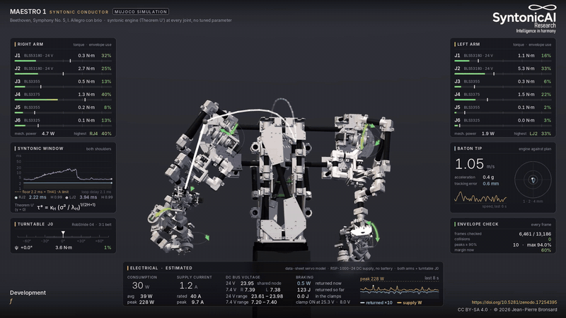

# Syntonic Engine: one formula, three facts about the machine, no tuning

**One formula, three facts about the machine, no tuning.** The syntonic engine sets the time window of a correction or an estimate from statistics measured in the signal, by a law derived from first principles (Theorem U' of the Syntony Principle). Its only machine-specific inputs are the loop timing and delay, the actuator's authority, and access to the read noise.

Jean-Pierre Bronsard · SyntonicAI Recherche · Montréal QC Canada  
ORCID: [0009-0008-6639-7553](https://orcid.org/0009-0008-6639-7553)

[](https://doi.org/10.5281/zenodo.23549689)

[](https://github.com/jpbronsard/syntonic-engine/releases/download/v0.1.0/MAESTRO1_Syntonic_Conductor_v4_web.mp4)

*MAESTRO 1 conducting Beethoven's Fifth in a MuJoCo simulation, every arm joint driven by this engine. Seven seconds from the full video: [download the full video](https://github.com/jpbronsard/syntonic-engine/releases/download/v0.1.0/MAESTRO1_Syntonic_Conductor_v4_web.mp4) (7:28, 1080p, 324 MB, CC BY-SA 4.0).*

---

## What is claimed, and what is not

On synthetic benches (`bench/software_2026-10-26/`) the engine stays within a few percent of the best fixed window and of Bayesian Kalman banks fitted with a change detector wherever the signal belongs to its class (a first-order window on a signal with a power-law structure function), tolerates increases of the sensor noise better than they do, and stays behind them where a second-order model applies (smooth targets, H >= 0.85: 25 %) or when the regime drifts fast. It does not notice when its class is the wrong one, because it computes its window instead of comparing candidates.

The hypothesis under test is portability: the same code, unchanged, reaching the optimum of its class on machines of different physics, each described by its three facts and nothing else. The substrates are a servo joint (ARM-1), a quadrotor on a gimbal, and, for the law rather than the code, a human in a tracking task. The pass criterion on each is the one of the software bench: window within a factor 1.5 of the swept optimum, regret under 10 %, exponent against U'. A failure on any of them is published as such and marks where the law stops. Nothing of this has run on hardware yet.

I developed this engine for MAESTRO 1, a two-arm robot conductor I designed. It corrects each joint toward its planned motion, and the time window it uses for that correction comes from the Syntony Principle (Theorem U'). Nothing in it is tuned per machine; the design constants it carries (scales, averaging time, warm-up, rate limit, gate) are the same everywhere, and the portability hypothesis stands or falls with them.

Every joint controller has to decide how long to average its sensor before it corrects. Average too briefly and the joint chases sensor noise. Average too long and it falls behind the motion. A PID makes that decision through gains found by trial, one joint at a time. This engine measures what the decision depends on while the robot moves (the sensor noise, and how fast and how smoothly the motion changes) and computes the window directly:

```
tau* = kappa_H * (sigma^2 / lambda_H) ^ (1 / (2H + 1)),     kappa_H = (2H * Gamma(2H + 1)) ^ (-1 / (2H + 1))
```

Here sigma^2 is the encoder noise intensity (the variance of one read times the loop period), and lambda_H and H describe how strongly and how smoothly the motion changes. With H = 1/2 the formula reduces to the classical square-root law, tau* = sqrt(sigma^2 / lambda). The window never drops below the loop delay, because a correction cannot usefully act faster than the loop can respond.

## How it works

On every loop tick, for every joint:

1. Read the encoder twice. The difference between the two reads gives the noise, and their mean gives the measurement.
2. Compare the measurement with a nominal model of the servo, driven by the plan and by the commands actually sent. What is left over is what the correction has to cancel. Measuring it this way keeps the engine from reading its own corrections back as motion.
3. Track how that residual changes across time scales (its structure function), subtract what the read noise alone would produce, keep the finest scales that stand clear of the noise, and fit its smoothness H and intensity lambda_H. Since 0.2.0 this is done on the means of adjacent blocks of 2 ms to 4 s (the Allan-variance construction), which keeps the fit valid when the sensor is noisy; see *Two identifications* below.
4. Compute the window from the formula, keep it between the floor described below and 0.5 s, and let it move smoothly.
5. Integrate the error over that window and add the result to the planned position at each servo frame.

## What you need to provide

Three facts about your hardware. There is nothing to tune. In general terms: the loop timing and its delay (which set the window floor), the actuator's authority (what a correction may ask of it), and access to the read noise (two independent reads per tick, or a known noise statistic). For a servo joint they are:

| | MAESTRO 1 |
|---|---|
| loop period `dt` | 1 ms (1 kHz) |
| servo frame period `frame` | 3 ms (333 Hz PWM) |
| servo no-load speed `w0` and nominal reaction time `servo_tau` | from the data sheet; 25 ms if it gives none |

The window floor follows from these. It is the loop delay (half a frame, plus half a tick, plus 0.1 ms for the sensor) or the discretisation limit dt / 0.45, whichever is larger. For a 1 kHz loop driving 333 Hz servos that comes to 2.22 ms. The formula leaves out the servo's own internal latency, so on real hardware measure the full loop delay once and, if it is larger, pass it as `floor`.

Each encoder has to be read twice per tick, at least one internal sample apart so that the two reads carry independent noise. An AS5048 refreshes at about 11 kHz, so the reads should be about 0.1 ms apart, which fits easily in a 1 ms tick.

## Two identifications, and where each is valid

The 0.1.x engine measured the residual's structure function on the raw reads at lags of 2 to 64 ms. That is exact where the motion over 64 ms is far above the read noise, which is the case of the MAESTRO 1 joint bench (AS5048 encoders, conducting motion). It is not the case of a noisy sensor or a slow motion: a software bench on 26 October 2026 (fractional Brownian targets, H from 0.30 to 0.95, read noise placing the optimal window from 5 to 160 ms) found that as soon as the signal falls below the noise floor at 64 ms, the raw fit has no usable lag, H collapses to its clip and the window drifts by a factor of 2 to 3. The lag at which the signal clears the floor grows from 0.1 s to 100 s over that range, so no fixed raw-read lag set can cover it.

Version 0.2.0 therefore identifies on **block means** by default (`identification='allan'`): the structure function of adjacent block means of length l, l from 2 ms to 4.096 s in powers of two. For white read noise its noise part is exactly n2 dt / l (n2 the per-read variance measured from the two reads) and is subtracted analytically; the signal part is lambda_H C(H) l^(2H) with C(H) = (2^(2H+2) - 4) / ((2H+1)(2H+2)), which is 2/3 at H = 1/2 (the Allan variance of a random walk). The fit uses the six finest scales that clear the floor, so that the scaling it measures is the local one, at the operating scale. On the software bench this lands within 7 % of the best fixed window in all 35 cells (regret at most 6.5 %), where the raw identification failed in 21 of them.

The two identifications on the MAESTRO 1 joint bench (the table below, `python examples/servo_bench.py --allan` prints both):

| Condition | Tip error, PID / raw / allan | Tip jitter, PID / raw / allan |
|---|---|---|
| A, steady noise | 0.732 / 0.734 (x1.00) / 0.749 (x1.02) | 0.651 / 0.561 (x0.86) / 0.603 (x0.93) |
| A, noise step | 1.330 / 0.922 (x0.69) / 1.033 (x0.78) | 1.261 / 0.695 (x0.55) / 0.900 (x0.71) |
| B, steady noise | 1.193 / 1.275 (x1.07) / 1.274 (x1.07) | 0.713 / 0.769 (x1.08) / 0.775 (x1.09) |
| B, noise step | 1.631 / 1.450 (x0.89) / 1.487 (x0.91) | 1.284 / 0.958 (x0.75) / 1.056 (x0.82) |

In the servo regime the raw identification remains a few percent better, mostly during the noise step, because its averages react in one second at every lag while the block means of long scales need several blocks. The default is nevertheless `allan`, because it holds on any sensor; `identification='raw'` reproduces the 0.1.x results bit for bit (the example and the replay tool use it for that reason). All three implementations carry both identifications, selected by `identification` in Python, `Config::identification` in C++ (`syntonic::ALLAN` or `syntonic::RAW`) and in Rust (`Identification::Allan` or `Identification::Raw`).

The complete software bench (scripts with pre-registered hypotheses, SHA-256 of each script, tables, per-seed rows and the bench note) is in `bench/software_2026-10-26/`; its headline beyond the fix above: against Bayesian Kalman banks the engine is at parity in stationary and slowly drifting regimes, better after sensor-noise increases, behind after noise decreases and fast drift, and a constant-velocity Kalman beats any first-order window by 25 % on smooth targets (H >= 0.85). The engine does not notice when its class is the wrong one, because it computes its window instead of comparing candidates.

## Quick start in Python

```python
from syntonic_engine import SyntonicEngine           # pip install -e python   (needs only numpy)

# q0, no_load_speeds, read_encoders, q_plan, servo_frame_due and send stand for your own code

eng = SyntonicEngine(q0, dt=0.001, frame=0.003, w0=no_load_speeds)   # radians and seconds
while running:
    a, b = read_encoders(), read_encoders()          # two reads of every joint
    cmd = eng.step(q_plan(t), a, b)                  # planned angles in, command out
    if servo_frame_due(): send(cmd)
    # eng.tau holds each joint's window (s), eng.H the measured smoothness
```

## On a Teensy or another microcontroller (C++)

`cpp/SyntonicEngine.h` is a single header with the same arithmetic in double precision, which the Teensy 4.x handles in hardware.

```cpp
#include "SyntonicEngine.h"
syntonic::Engine<6> eng;  syntonic::Config cfg;  cfg.dt = 0.001;  cfg.frame = 0.003;
eng.begin(q0, w0, cfg);
// on each tick:  const double* cmd = eng.step(q_plan, read_a, read_b);
```

A sketch to start from is in `examples/teensy/SyntonicJoint.ino`. You fill in the encoder and servo calls for your board.

## In Rust

`rust/` is a `no_std` crate with no allocation (math from `libm`), so it suits embedded Rust as well as a PC:

```rust
use syntonic_engine::{Config, Engine};
let mut eng: Engine<6> = Engine::new(&q0, &w0, Config { dt: 0.001, frame: 0.003, ..Config::default() });
// on each tick:  let cmd = eng.step(&q_plan, &read_a, &read_b, None);
```

See `rust/README.md` for details.

## Results on the MAESTRO 1 joint bench (simulation)

These results were obtained with the raw identification (`identification='raw'`, the 0.1.x engine); the example reproduces them as printed. The bench simulates the twelve arm joints of MAESTRO 1 conducting the first movement of Beethoven's Fifth. Each joint has a servo model (333 Hz command frame, 25 ms internal loop, speed derating, compliance, gear play), AS5048 encoder noise, and loads from the inverse dynamics of the planned motion. The opponent is a PID with interpolation. Its gains were picked joint by joint from a grid of 280 (P, I, D) combinations, each tried on all twelve joints over the rest of the same movement with normal noise. Both run on two held-out 30 s excerpts, once with steady noise and once with the encoder noise variance raised tenfold for 10 s. The figures below are for the baton arm and come from `examples/servo_bench.py`. A ratio below 1 means the syntonic engine did better.

| Condition | Tip error (mm), PID / syntonic | Tip jitter (mm), PID / syntonic | Joint error (deg), PID / syntonic |
|---|---|---|---|
| A, steady noise | 0.732 / 0.734 (x1.00) | 0.651 / 0.561 (x0.86) | 0.0309 / 0.0395 (x1.28) |
| A, noise step | 1.330 / 0.922 (x0.69) | 1.261 / 0.695 (x0.55) | 0.0538 / 0.0475 (x0.88) |
| B, steady noise | 1.193 / 1.275 (x1.07) | 0.713 / 0.769 (x1.08) | 0.0489 / 0.0627 (x1.28) |
| B, noise step | 1.631 / 1.450 (x0.89) | 1.284 / 0.958 (x0.75) | 0.0674 / 0.0701 (x1.04) |

Repeated over ten paired noise draws per condition (see `bench/`), the tip ratios are 1.006 [1.000, 1.013], 0.709 [0.697, 0.722], 1.063 [1.060, 1.066] and 0.889 [0.882, 0.897], with 95 % intervals.

What this shows:
- The baton tip was the bench's main score, fixed before any run. There, the syntonic engine matches the tuned PID under steady noise (a tie on one excerpt, 7 % behind on the other) and does better when the noise jumps (11 % to 31 % less error). It does this with no tuning at all.
- Scored joint by joint, the syntonic engine's error is about 28 % larger than the PID's under steady noise. That is the error the PID's gains were chosen to minimise. The syntonic engine's larger joint errors largely cancel at the tip: if they were independent, its tip error would be about 25 % higher than the PID's, and it is only 0 to 7 % higher. We do not yet know why they cancel.
- Limits: this is one simulated servo model, and its 25 ms reaction time is an assumption that happens to match the engine's nominal model exactly. It covers two excerpts of one piece, and nothing has run on real hardware yet. Drift in the servo itself (slower response, worn gears) has not been tested.

The window floor was tested on its own (`bench/`, runs v8 and v9). Set to the loop delay, it lands within 0.4 % of the best floor found by sweeping, for servo frames of 2, 3, 5 and 8 ms. A window shorter than the loop delay costs accuracy, and with slow servo frames it makes the loop ring. One case is still open: with the loop itself at 333 Hz, the rule was 7 % off the best floor (see the bench note).

## Checks

- The Python engine in `python/syntonic_engine` with `identification='raw'` reproduces the bench engine exactly: zero difference in joint angles and windows over 33 s on 12 joints; a unit test pins it to the 0.1.1 numbers.
- On the same 33 s, 12-joint replay, the C++ header agrees with the Python engine to 1.5e-14 rad (raw identification) and 7.8e-16 rad (block means); the Rust crate to 5.4e-14 rad and 8.9e-16 rad.
- The block-mean identification is unit-tested on a fractional Brownian target with read noise large enough to defeat the raw one (`python/tests`).
- `examples/arm_fk.py`, the baton-tip kinematics in plain numpy, agrees with MuJoCo to 7e-16 m over 200 random poses.
- Neither the C++ header nor the Rust crate has run on a microcontroller yet. The Rust crate builds as `no_std` but has not been cross-compiled for a Cortex-M board, and the Teensy sketch has only been compiled on a PC against stand-ins for the Arduino functions.

To run the checks yourself, from the repository root (Python 3.9 or later, a C++11 compiler, and a recent stable Rust):

```
pip install -e python scipy
python -m unittest discover -s python/tests          # unit tests of the Python engine
python examples/servo_bench.py                       # the results table above, about a minute; add --allan for both identifications
python rust/tools/make_replay_log.py                 # writes replay_log.bin (raw), replay_log_allan.bin and replay_w0.bin
g++ -O2 -std=c++11 -Icpp cpp/tests/replay.cpp -o replay_cpp
./replay_cpp replay_log.bin replay_w0.bin raw && ./replay_cpp replay_log_allan.bin replay_w0.bin allan
cd rust && cargo test && cargo run --release --example replay -- ../replay_log.bin ../replay_w0.bin raw \
        && cargo run --release --example replay -- ../replay_log_allan.bin ../replay_w0.bin allan
```

## What is in the repository

```
python/syntonic_engine/   the engine (numpy), with unit tests in python/tests/
cpp/SyntonicEngine.h      the engine as a single C++ header (both identifications), with a replay test in cpp/tests/
rust/                     the engine as a no_std Rust crate, with a replay check against Python
examples/                 servo_bench.py (the table above, numpy + scipy), arm_fk.py, data/, teensy/
bench/                    the MAESTRO 1 joint bench scripts and every result file (the scripts need the MAESTRO 1
                          simulation model, which is not included, but all results are), and the software bench
                          of 26 Oct 2026 against adaptive estimators (software_2026-10-26/, self-contained)
docs/bench_note.md        the bench note: setup, the predictions written before each run, results and failures
```

## Citing

If you use this work, please credit me (see NOTICE and CITATION.cff):

- this software: J.-P. Bronsard, *Syntonic Engine*, Zenodo, https://doi.org/10.5281/zenodo.23549689 (this DOI always points to the latest version; each release also has its own DOI on Zenodo)
- the theory: J.-P. Bronsard, *The Syntony Principle*, Zenodo, https://doi.org/10.5281/zenodo.17254395

## Licence

Apache License 2.0 (see LICENSE). Any redistribution or derivative work must keep the NOTICE file.

## Authorship

Code and documentation were drafted with language models under the author's direction, as solution architecture and integration of independent components. The author alone approves every statement and is accountable for it; no language model is an author.

Jean-Pierre Bronsard, SyntonicAI Recherche, 2026.
